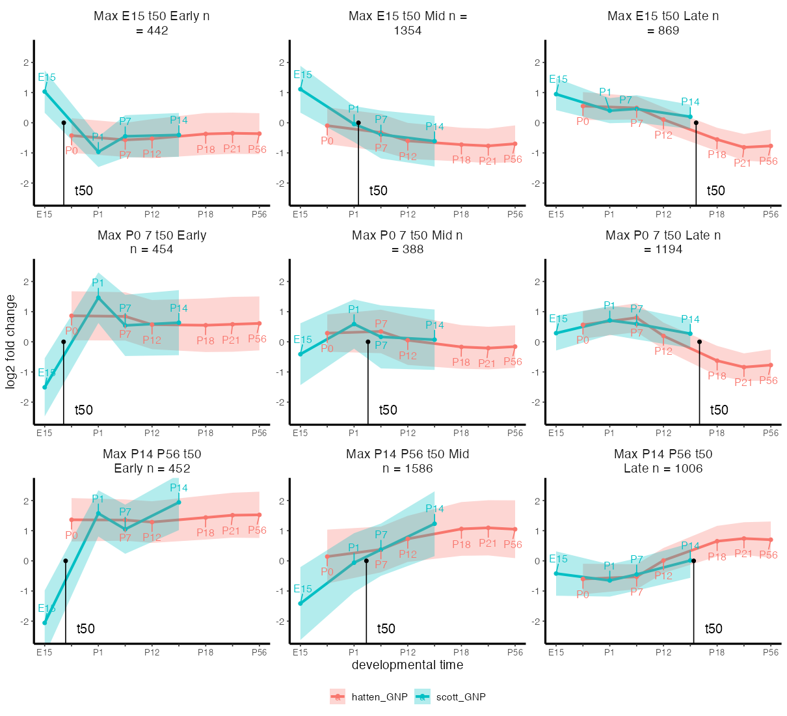
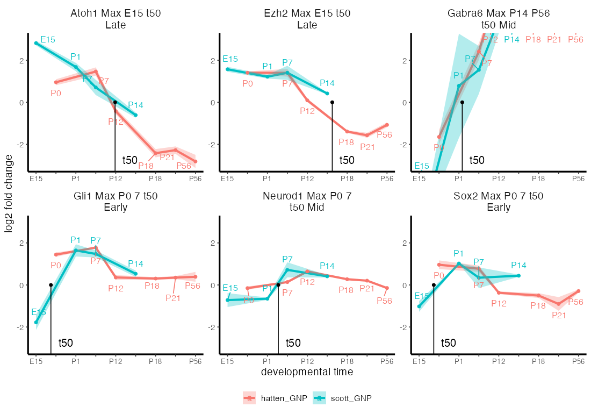
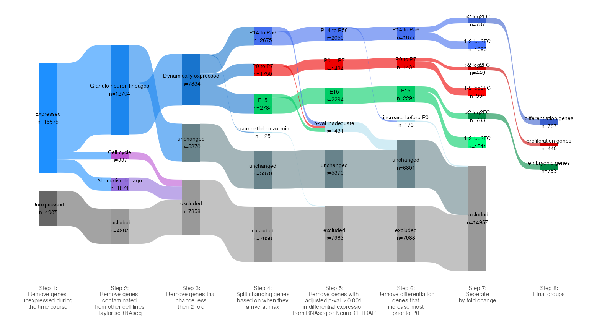

# merged_transcript

Merged mouse cerebellar **granule-neuron-precursor (GNP) developmental
timecourse** — two independent transcriptomic series aligned onto a common
pseudo-time axis and reduced to per-transcript kinetics (when a gene switches,
how much it changes, and in which direction), with a **query API** so other
agents can ask about any gene and a set of reproducible **timecourse figures**.

```
Scott RNA-seq (E15,P1,P7,P14)  ┐
                               ├─ interpolate → align → t50 / log2FC / direction
Hatten TRAP array (P0…P56)     ┘   → kinetic classes → query index + figures
```

Pseudo-time axis: **E15 → P0 → P1 → P7 → P12 → P14 → P18 → P21 → P56**.
Coverage: 24,379 genes / 24,525 transcripts.

Data sources: the Hatten TRAP arm (P0–P56) is the Hatten-lab granule-neuron
NeuroD1-TRAP data, GEO [GSE74400](https://www.ncbi.nlm.nih.gov/geo/query/acc.cgi?acc=GSE74400)
(Zhu et al., *Neuron* 2016); the Scott RNA-seq arm (E15–P14) was generated for
Purzner et al. 2025. See [`references/`](references/).

## Quick start

```bash
# Query a gene (JSON by default)
Rscript R/query_gene.R Ezh2

# Compare several, as a table
Rscript R/query_gene.R Ezh2 Gabra6 Sox2 Atoh1 --format table \
  --fields gene,t50,log2fc,direction_label,kinetic_class,fc_class

# Get the numerical timecourse (per-time-point values behind the plot)
Rscript R/timecourse_values.R Ccnd1
Rscript R/timecourse_values.R Ezh2 Gabra6 --format table

# Render a timecourse plot for one or more genes
Rscript R/query_gene.R Ezh2 Neurod1 --plot --plot-format png

# Regenerate the standard figure set
Rscript R/run_pipeline.R --step plots

# Gene-classification Sankey (paper Fig S1: 783 embryonic / 440 proliferation / 787 differentiation)
Rscript R/figures/sankey_classification.R
```

Each gene carries a `gene_program` label (`embryonic` / `proliferation` /
`differentiation`) following **Purzner et al. 2025** (eLife
[10.7554/eLife.105339.1](https://doi.org/10.7554/eLife.105339.1)), the paper
this dataset underlies — see `references/`.

## Example figures

**Developmental kinetics of every changing transcript**, grouped into the nine
kinetic classes (time of peak × t50), both datasets overlaid (mean ± SD) with
the median t50 marked:



**Marker genes** across the differentiation axis — progenitor/proliferation
genes falling (*Ezh2*, *Gli1*), mature-neuron genes rising (*Gabra6*):



**Gene-classification Sankey** (paper Fig S1) — the stepwise filter that defines
the three gene programs, reproducing the published set sizes (783 embryonic /
440 proliferation / 787 differentiation):



Regenerate with `Rscript R/run_pipeline.R --step plots` and
`Rscript R/figures/sankey_classification.R`.

See **[docs/SKILL.md](docs/SKILL.md)** for the field dictionary, the JSON
schema, and the biological interpretation guide — that is the document an
agent should read before querying.

## Layout

```
merged_transcript/
├── R/
│   ├── query_gene.R              ← the API: gene -> kinetics (JSON/table/tsv), optional plot
│   ├── timecourse_values.R      ← the numerical timecourse: gene -> per-time-point values
│   ├── run_pipeline.R            ← orchestrator (--step normalize|align|merge|plots|index|all)
│   ├── 01_normalize_and_merge.R ← STAGE 1: DESeq2-normalize Scott, 2^ Hatten, merge on annotation
│   ├── 02_align_timecourse.R    ← STAGE 2: interpolate + align -> alignment datasets + t50 table
│   ├── 03_timecourse_plots.R    ← generate the standard figures
│   ├── 04_build_query_index.R   ← slim the 115-col table into the query index
│   ├── figures/sankey_classification.R ← gene-classification Sankey (paper Fig S1)
│   └── lib/                       ← shared helpers (common.R) + the timecourse functions
├── python/                        ← Python recreation, generalized to N datasets (see python/README.md)
├── analysis/                      ← source Rmds for all the RNA-seq figures (see analysis/README.md)
├── references/                    ← paper link, citation, gene-set mapping
├── data/                          ← see data/README.md for every dataset
│   ├── toc_t50_2023_05_17.txt      ← canonical merged table (shipped, 115 cols)
│   ├── timecourse_query_index.tsv  ← slim query index (built from the above)
│   ├── log2_norm_list_shift.RData  ← aligned expression matrices (for plotting)
│   └── raw/                         ← symlinks to raw inputs (git-ignored)
├── figures/                       ← generated timecourse images
└── docs/SKILL.md                  ← agent-facing skill document
```

## How the pipeline works

The rebuild is two stages (`--step normalize` then `--step align`, or
`--step merge` for both):

**Stage 1 — normalize + merge** (`01_normalize_and_merge.R`)
1. **Normalize.** Scott RNA-seq counts are DESeq2 size-factor normalized and
   tested across time (P7–P14, P1–P14, E15–P7). Hatten TRAP array values are
   un-logged (2^); limma adjusted p-values summarized to a per-gene minimum.
2. **Merge.** The two series are matched on Ensembl gene/transcript annotation
   to a shared set of transcripts → `data/normalized_merged.RData`.

**Stage 2 — align + summarize** (`02_align_timecourse.R`)
3. **Align.** Expression is row-normalized to log2 fold change vs each gene's
   own mean, averaged per time point, interpolated onto the E15–P56 day axis,
   and shifted so the two series' overlapping days agree. This produces the
   **alignment datasets** → `data/alignment_datasets.RData` (+ the
   `log2_norm_list_shift.RData` the figures use). See `data/README.md`.
4. **Summarize.** Per transcript from the aligned data: `t50` (time to 50% of
   total change), `log2fc`, `direction`, time of peak, and an expression call
   → **kinetic class** (`Max_<when-it-peaks> t50_<when-it-switches>`) →
   `toc_t50`.

**Serve.** `04_build_query_index.R` slims `toc_t50` into the index that powers
`query_gene.R`; the aligned matrices power the figures (`03_timecourse_plots.R`).

## Python & adding datasets

[`python/`](python/) is a Python recreation of this pipeline, **generalized to
any number of datasets** and to **incrementally adding** a dataset to an
existing merge:

```python
from merged_timecourse import merge_datasets, add_dataset
merged = merge_datasets([scott, hatten, third, ...])   # N datasets
merged = merged.add_dataset(new_dataset)               # anchors onto the existing merge
```

On the same normalized inputs it reproduces the R `toc_t50` kinetics (avg_max
identical, t50 / fold-change r = 1). See [`python/README.md`](python/README.md).

## Requirements

- R ≥ 4.2 with: `DESeq2`, `dplyr`, `tidyr`, `tibble`, `reshape2`, `ggplot2`,
  `ggrepel`, `plyr`, `matrixStats`, `stringr`, `akima`, `DescTools`,
  `mixtools`, `jsonlite`.
- Only `jsonlite` + base R are needed for the query API itself; the heavier
  packages are for the merge (`--step merge`) and plotting.

The API and figures run from the shipped precomputed data with no rerun of the
merge. `--step merge` re-derives the table from the raw inputs and is the
documented-reproducible path; it reproduces the canonical kinetic metrics
exactly (t50 / fold change / time-of-max: r = 1) and ~93% of the categorical
kinetic-class calls (the remainder differ only at the expression-binarization
cutoff — see `docs/SKILL.md`).

## Citation

If you use this dataset or code, please cite the eLife paper this work is part of:

> Purzner J, Brown AS, Purzner T, Ellis L, Broski S, Litzenburger U, Andrews K,
> Sharma A, Wang X, Taylor MD, Cho Y-J, Fuller MT, Scott MP.
> **Ezh2 Delays Activation of Differentiation Genes During Normal Cerebellar
> Granule Neuron Development and in Medulloblastoma.** *eLife* (2025), reviewed
> preprint. DOI: [10.7554/eLife.105339.1](https://doi.org/10.7554/eLife.105339.1).

See [`CITATION.cff`](CITATION.cff) (GitHub's "Cite this repository") and
[`references/`](references/).

## License

MIT — see [LICENSE](LICENSE). Citing the paper above is requested for any use of
the data or figures.
